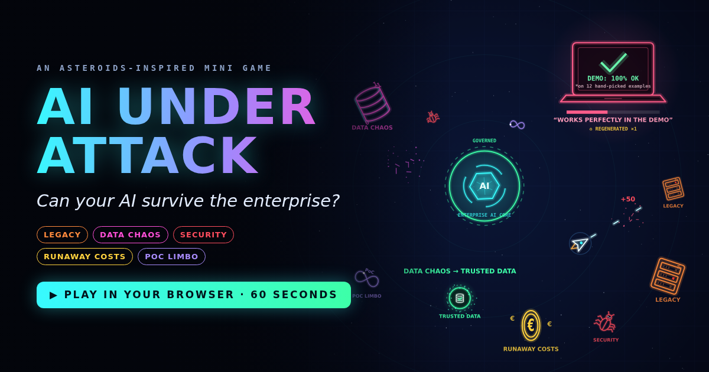

# AI UNDER ATTACK

**Can your AI survive the enterprise?**

An Asteroids-inspired mini game that runs in any browser. Your ship *is* the AI: protect the **Enterprise AI Core** for 60 seconds.

## ▶ Play

**[Play it in your browser](https://TUO-UTENTE-GITHUB.github.io/ai-under-attack/)**. It works on desktop and mobile, with nothing to install.

## How it works

Shoot the threats down. The smallest fragments can **transform into enablers**: fly through them to activate.

| Threat | Effect | Transforms into | Effect |
|---|---|---|---|
| LEGACY | Slows your ship down | GOVERNANCE SHIELD | Shields the AI core for 8 s |
| DATA CHAOS | Scrambles your sensors | TRUSTED DATA | Clean sensors + triple shot |
| SECURITY | Drains your shield | SECURITY BY DESIGN | Shield fully restored |
| RUNAWAY COSTS | Burns your energy | FINOPS | Full energy + free shots |
| POC LIMBO | Traps you (mash FIRE to escalate) | HUMAN OVERSIGHT | Slows every threat, frees you |

The game runs in four phases: **Pilot → Scale-up → Integration → Go-Live**. Then the final boss shows up: **"Works Perfectly in the Demo"**. Every time you beat it, it regenerates.

## Controls

| Action | Keyboard | Touch |
|---|---|---|
| Rotate | ← → (or A / D) | ↺ ↻ |
| Thrust | ↑ (or W) | ▲ |
| Fire | Space | FIRE |
| Pause / sound | P / M | Buttons at the top right |

## Endings

- **Demo-grade:** *"Your AI survived the demo. Production is another galaxy."*
- **Pilot-grade:** *"Your AI is promising. Now make it enterprise-ready."*
- **Production candidate:** *"AI protected. Enterprise-ready? Prove it."*

## Under the hood

One self-contained `index.html` file: HTML5 canvas and Web Audio, with no libraries, no build step and no tracking. It also works offline: download `index.html` and open it in any browser.

---

*Building an AI model is relatively easy. Building an AI system that survives the enterprise is another story.*
